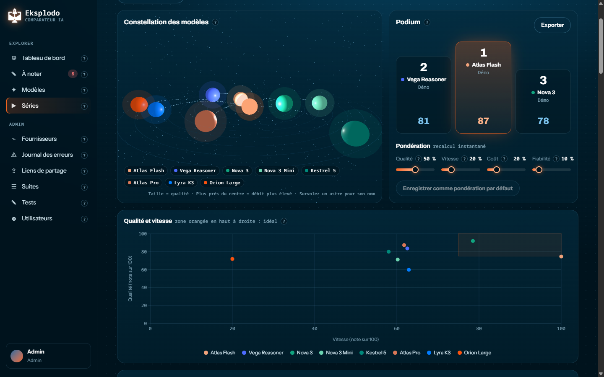
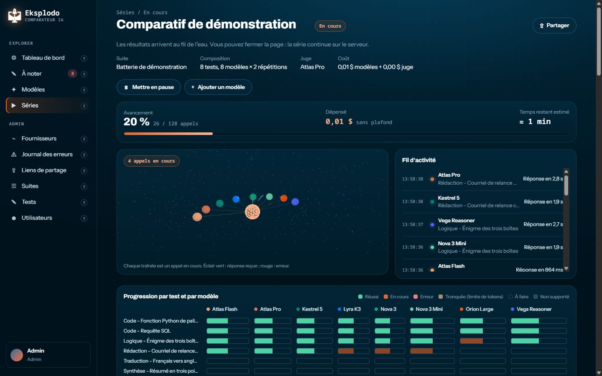
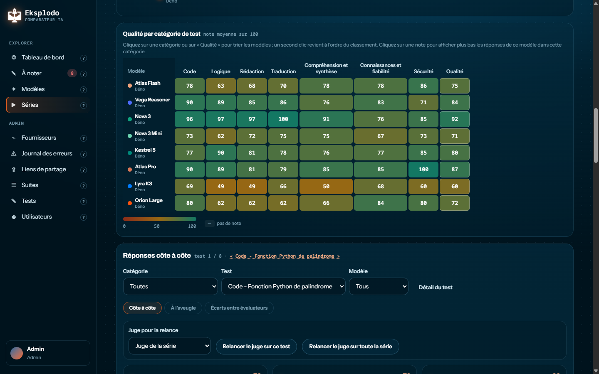
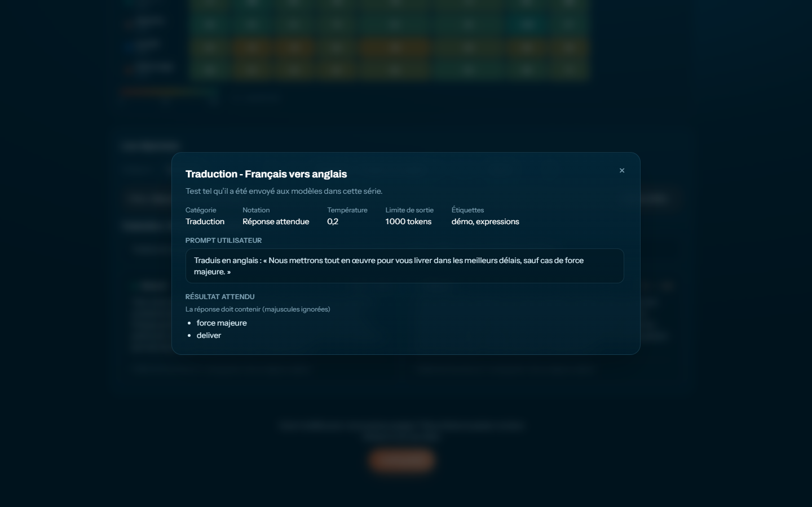
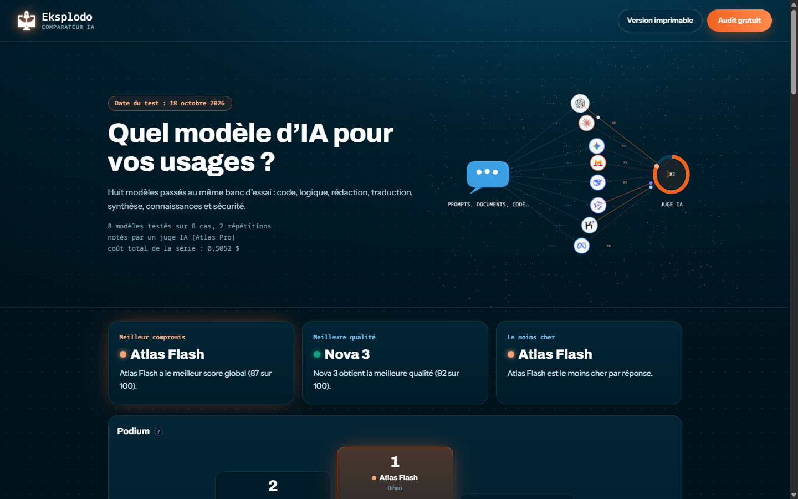
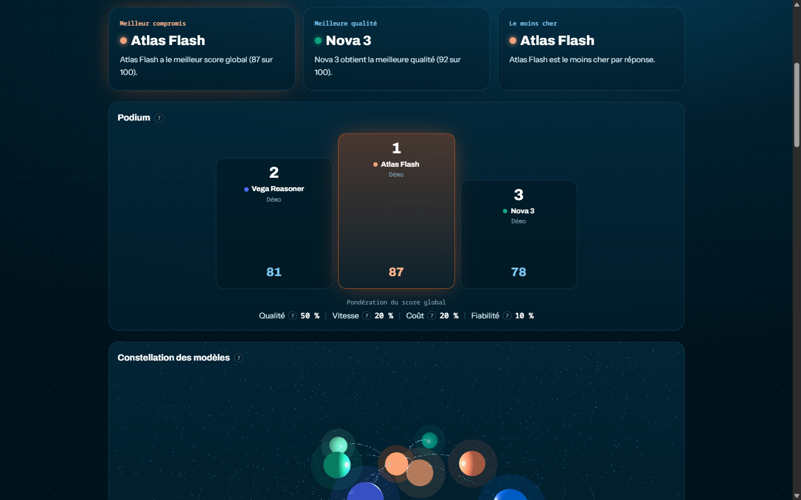
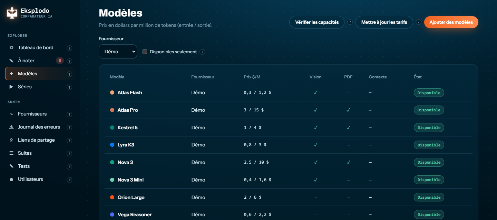
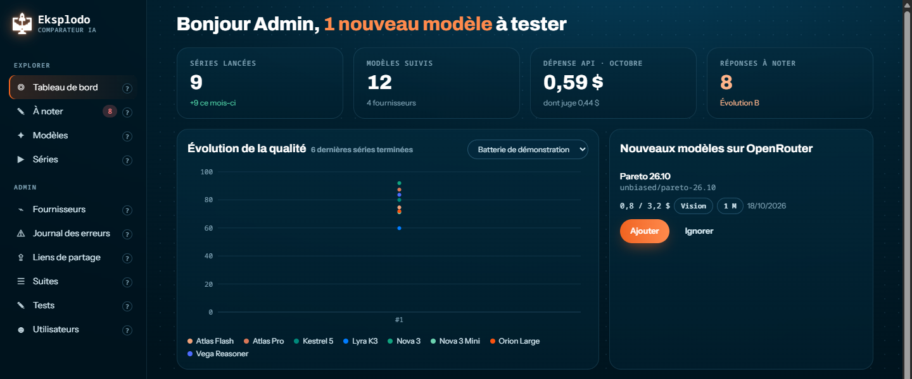

# Eksplodo · Comparateur IA

**Comparez les modèles d'IA sur vos propres cas d'usage, pas sur des benchmarks génériques.**

Soumettez les mêmes tests (prompts, documents, images) à plusieurs modèles, faites-les noter automatiquement ou à l'aveugle, puis comparez qualité, vitesse, coût et fiabilité. Partagez ensuite le résultat dans une page publique soignée.




> Les captures de ce README ont été réalisées avec des **données de démonstration** : fournisseur fictif, modèles aux noms inventés, notes imposées pour l'exemple.

## Pourquoi ce comparateur ?

Les classements publics disent quel modèle est le meilleur « en général ». Une entreprise veut savoir lequel répond le mieux **à ses questions**, sur **ses documents**, à **quel prix** et en **combien de temps**. Le comparateur fait passer le même banc d'essai à tous les modèles choisis, chez tous vos fournisseurs, et met les résultats côte à côte.

## Fonctionnalités

### Des tests à votre image

- Un **test** réunit un prompt, une consigne système facultative, des pièces jointes (images, PDF) et une méthode de notation.
- Les tests se regroupent en **suites** (par exemple « Batterie complète ») et se rangent par catégorie et étiquettes.
- Trois façons de noter :
  - **réponse attendue** : réponse exacte, éléments à trouver ou expression régulière ;
  - **juge IA** : un modèle juge note chaque réponse selon vos critères, avec sa justification ;
  - **notation manuelle à l'aveugle** : chacun note les réponses désignées par des lettres, sans connaître le modèle.

### Des séries suivies en direct

Une **série** croise des tests, des modèles et un nombre de répétitions. L'estimation du coût s'affiche avant le lancement, puis la progression se suit en temps réel. On peut mettre en pause, ajouter un modèle en cours de route ou relancer les erreurs. Une série reprend seule après un redémarrage du serveur.



### Des résultats lisibles

- **Podium** et **score global** sur 100, recalculés instantanément selon votre pondération : qualité, vitesse, coût et fiabilité.
- **Constellation 3D** : la taille de chaque astre suit la qualité du modèle, sa distance au centre suit son débit.
- **Qualité et vitesse** : un nuage de points qui fait ressortir les modèles à la fois bons et rapides.
- **Qualité par catégorie** : une matrice colorée. Un clic sur une note filtre les réponses de ce modèle dans cette catégorie.
- **Réponses côte à côte**, filtrables par catégorie, test et modèle, avec la note et la justification du juge.
- **Export Excel** et métriques par modèle : premier token, débit, coût par réponse, tarifs.



Le nom de chaque test ouvre son détail : prompts envoyés, paramètres et résultat attendu.



### Une page publique à partager

Depuis une série, un lien de partage crée une page publique en lecture seule, sans compte. Elle présente des verdicts (« Meilleur compromis », « Meilleure qualité », « Le moins cher ») recalculés à chaque affichage, le podium avec sa pondération, les graphes et, si vous le choisissez, les coûts et les réponses. La page a aussi une **version imprimable** (PDF).





### Un catalogue de modèles toujours à jour

- **Fournisseurs** préconfigurés : OpenRouter, OpenAI, Anthropic, Google, Mistral, DeepSeek, Requesty et Eden AI. Tout service compatible OpenAI, Anthropic ou Google peut s'ajouter.
- **Vérifier les capacités** : trois tout petits appels suffisent pour savoir si un modèle accepte vraiment les images et les PDF.
- **Mettre à jour les tarifs** d'après la liste de modèles de chaque fournisseur. Les nouveautés d'OpenRouter sont signalées chaque jour.



### Un tableau de bord

Séries lancées, dépense du mois (dont la part du juge), réponses qui attendent votre note, évolution de la qualité d'une série à l'autre et nouveaux modèles à tester.



### Sécurité

- Les **clés API** des fournisseurs se saisissent dans l'interface. Elles sont chiffrées en base (AES-256-GCM) et liées à leur fournisseur.
- Comptes sur invitation, rôles **Admin** et **Utilisateur**, protection CSRF, limitation de débit.
- Les pages publiques sont construites **champ par champ** : aucun identifiant interne ni note individuelle d'évaluateur n'y figure.

## Essayer en local

Prérequis : Node.js 24 et une base MariaDB 11 (le plus simple : Docker).

```bash
git clone https://github.com/lwiart/Eksplodo-AI-Comparator.git
cd Eksplodo-AI-Comparator
cp .env.example .env
docker compose up -d db
npm install
npm run dev
```

Dans `.env`, renseignez au minimum `APP_ENCRYPTION_KEY` et le premier compte Admin (`BOOTSTRAP_ADMIN_EMAIL`, `BOOTSTRAP_ADMIN_PASSWORD`). Ajoutez `AIC_FAKE_LLM=1` pour essayer sans aucun appel payant : un faux fournisseur répond à la place des vrais. L'interface s'ouvre sur http://localhost:5173.

Le détail (variables, tests automatisés, règles de calcul, directives du faux fournisseur) est dans le [guide technique](docs/developpement.md).

## Mettre en ligne

Le [guide de déploiement](docs/deploiement.md) décrit la mise en production : variables d'environnement, base de données, tâche planifiée, vérifications et dépannage. Il prend l'exemple d'un hébergement Hostinger, mais tout hébergeur Node.js 24 + MariaDB convient.

## Sous le capot

| Côté | Technologies |
|---|---|
| Serveur | Fastify 5, TypeScript, Drizzle ORM, MariaDB 11, file de tâches en base |
| Interface | React 19, Vite 8, Tailwind CSS 4, TanStack Query, Recharts, Three.js |
| Qualité | Vitest et Testing Library : plus de 1 100 tests, serveur et interface |

## Documentation

- [Guide technique](docs/developpement.md) : installation, commandes, notation, calcul du score, partage.
- [Guide de déploiement](docs/deploiement.md) : mise en production et exploitation.
- [Spécification](docs/superpowers/specs/2026-10-16-comparateur-ia-design.md) et [plans de réalisation](docs/superpowers/plans/).

## Licence

Code publié sous [licence MIT](LICENSE) : vous pouvez l'utiliser, le modifier et le redistribuer, y compris à des fins commerciales, en conservant la mention de copyright.

---

## À propos de l'auteur

**Laurent Wiart** est formateur IA et consultant en automatisation. Il a fondé [**Eksplodo**](https://eksplodo.fr) en 2021, à Labenne (Landes). Il accompagne les TPE et PME pour qu'elles récupèrent le temps que leurs processus manuels leur prennent : IA générative, agents IA et automatisation avec Make, n8n, Airtable et Notion.

- Plus de 26 ans d'expérience dans le digital, dont neuf ans à concevoir des dispositifs médicaux logiciels en environnement réglementé (ISO 13485, IEC 62304, FDA) et des programmes d'innovation autour de l'IA.
- Plus de 1 000 apprenants formés et 150 entreprises accompagnées, en présentiel dans le Sud-Ouest et à distance partout en France.
- Make Expert Level 5, n8n Level 2, Airtable AI Builder et 12 certifications Anthropic Claude.

Ce comparateur est né d'un besoin de terrain : aider chaque entreprise à choisir le bon modèle pour **ses** usages.

[Site Eksplodo](https://eksplodo.fr) · [À propos](https://eksplodo.fr/a-propos/) · [LinkedIn](https://www.linkedin.com/in/laurentwiart/) · [YouTube](https://www.youtube.com/channel/UCXZxPKi3-oAsGrhL7HGgtJA) · [Audit gratuit](https://eksplodo.fr/#audit-gratuit)
